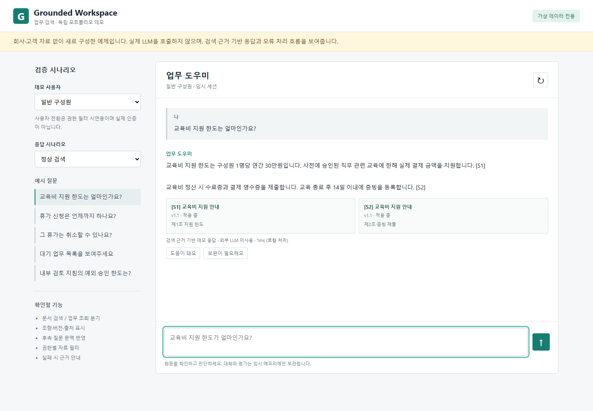

# Grounded Workspace

가상 데이터만 사용하는 독립 업무 검색 챗봇 포트폴리오 데모입니다.
원본 회사 프로젝트의 소스, 커밋 이력, 고객 문서, 회사 화면, 내부 설정을 복사하지 않고 새로 작성했습니다.
이 저장소는 고객사 납품본이나 운영 시스템이 아니며, 회사 프로젝트와 구현 스택 및 범위가 다릅니다.



## 실행

Node.js 22 이상이 필요합니다. 외부 패키지 설치, DB, 계정, API 키 없이 실행할 수 있습니다.

```sh
npm start
# http://127.0.0.1:5187
npm test
npm run check
```

다른 포트가 필요하면 환경 변수 PORT를 설정합니다. 기본 바인딩은 로컬 루프백입니다.

## 보여주는 기능

| 상황 | 처리 방식 |
| --- | --- |
| 문서 내용 질문 | 조항별 어휘 검색, 근거 문구 및 버전/원문 제공 |
| 업무 목록/현황 | 가상 업무 데이터 직접 조회 및 권한 필터 |
| 후속 질문 | 현재 세션의 이전 사용자 질문을 검색 점수에 반영 |
| 권한 밖 자료 | 검색과 원문 API 양쪽에서 제외 |
| 생성 서비스 장애 | 검색 근거 기반 대체 응답 |
| 잘못된 인용 | 허용된 근거 ID와 대조한 뒤 실패 시 대체 응답 |
| 답변 평가 | 해당 임시 세션의 메시지에만 평가 기록 |

화면에서 일반 구성원/검토 담당자와 정상/장애/잘못된 인용 시나리오를 선택할 수 있습니다.
자료와 금액은 모두 설명을 위해 새로 만든 가상 값이며 실제 취업규칙이나 고객 업무 기준이 아닙니다.

## 시연 순서

1. 일반 구성원으로 `교육비 지원 한도는 얼마인가요?` 질문 후 출처를 선택합니다.
2. `그러면 증빙은?`을 질문해 후속 문맥과 해당 조항을 확인합니다.
3. `대기 업무 목록`을 질문하고 사용자 변경 후 조회 건수를 비교합니다.
4. `내부 검토 지침의 예외 승인 한도는?`으로 권한별 검색 차이를 확인합니다.
5. 생성 서비스 장애 또는 잘못된 인용 시나리오에서 교육비를 질문합니다.

## 구조와 의도

브라우저 → Node HTTP API → 서버 세션의 사용자 → 질문 분기 → 권한 필터 → 검색 또는 업무 조회 → 출처 검증/대체 응답 → 화면

- `src/data.mjs`: 가상 사용자·조항·업무 레코드
- `src/assistant.mjs`: 질문 분기, 검색, 생성기 인터페이스, 인용 검증
- `server.mjs`: 독립 세션, 원문 조회, 질의·평가 API
- `public/`: 외부 리소스 요청 없는 화면
- `test/`: 핵심 로직 및 HTTP 통합 테스트

검색은 단순 어휘/문자쌍 점수이며 벡터 검색이나 임베딩을 구현했다고 주장하지 않습니다.
기본 UI는 실제 LLM을 호출하지 않는 검색 기반 데모입니다. 장애와 잘못된 인용도 명시적인 시뮬레이션입니다.
생성기는 테스트에서 함수로 주입합니다. 실서비스 모델 연동 및 프롬프트 품질 평가는 이 데모 범위 밖입니다.
인용 ID가 실제 검색 결과에 있는지 확인하는 것은 답변 전체의 의미적 정확성이나 환각 방지를 보장하지 않습니다.

## 테스트

`npm test`는 Node 내장 테스트 러너로 실제 검색·필터·분기·인용·실패 처리와 임시 HTTP 서버를 검증합니다.
네트워크 모델 호출은 없으며 생성 응답은 성공·실패·형식 오류를 주입해 검증합니다.
권한 밖 원문 직접 조회, 본문을 통한 역할 위조, 다른 세션 메시지 평가, 잘못된 입력도 포함합니다.
단위·HTTP 통합 테스트는 총 21개입니다. `docs/github-actions-example.yml`은 선택적으로 적용할 CI 설정 예제이며, 현재 자동 실행되지는 않습니다.
데스크톱(1440px)·모바일(390px)에서 질의, 원문 열기, 잘못된 인용의 대체 응답을 브라우저로 확인했습니다.

## 공개 범위와 한계

- 원본 저장소와 Git 이력을 연결하지 않습니다. 고객사명·로고·상품 문서·산출식·운영 주소를 포함하지 않습니다.
- 환경 파일, 키, DB 접속정보, 원본 업로드 파일, 대화 로그와 문서 파일이 필요하지 않습니다.
- 대화·평가는 서버 메모리에만 남고 재시작 시 삭제됩니다. 외부 전송·분석 수집을 하지 않습니다.
- 사용자 선택은 가상 권한 필터 시연입니다. 누구나 검토 담당자를 선택할 수 있으므로 실제 인증/권한 서비스가 아닙니다.
- 세션 용량 제한은 있으나 만료·영구 저장·로그인·호출 제한 등 운영 보안 기능은 없습니다.
- 기본 HTTP 쿠키는 로컬 실행용입니다. 외부 배포 시 HTTPS, Secure 쿠키, 인증, 요청 제한 등 별도 설계가 필요합니다.
- 새 데모가 원본 저장소의 과거 공개 자료를 삭제하거나 유출 여부를 해결하지는 않습니다.

## 포트폴리오 표기 예시

> 실제 업무 경험을 설명하기 위해 회사 코드와 자료를 사용하지 않고 새로 구현한 공개용 데모입니다.
> 가상 업무 문서로 질문 분기, 권한별 검색, 출처 표시, 오류 대응과 테스트를 확인할 수 있습니다.
> 이 데모는 Node.js 기반이며 외부 LLM과 벡터 검색을 사용하지 않습니다.
